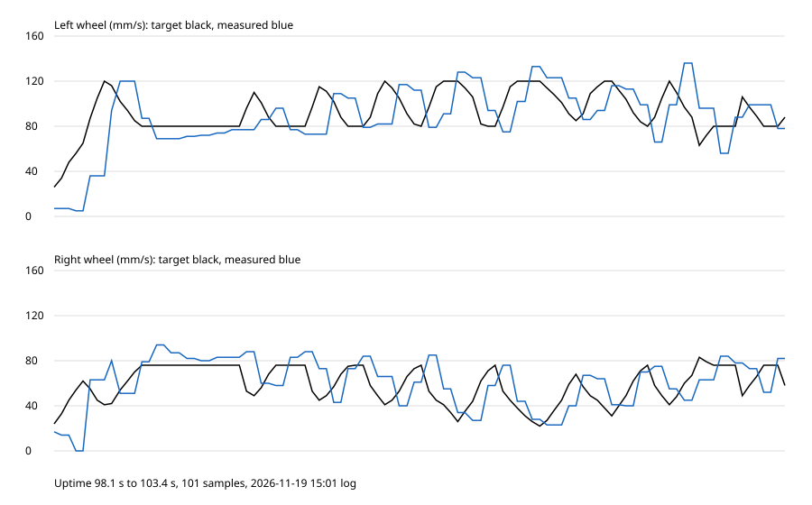

# Buddy 2 PID tuning report

Written 25 November 2026 from source on `main` at `d1e2871` and logs already
recorded. No new car test was run for it.

## Controller

One wheel-speed controller per wheel, run every 20 ms on a speed measured over
100 ms (`app_program/subsystem2/wheel_pid.c`):

effort = feedforward x target + P x error + I x integral of error + D term

- Effort is in per mille of full PWM and is limited to 0..`max_effort`.
- The integral stops growing while the output is at its limit (anti-windup) and
  is itself limited to 300.
- A wheel that has not moved gets at least the launch effort, for up to 500 ms.
- A zero target resets the controller.

## Final gains

`b2_move_candidate_profile()` in `app_program/diagnostics/b2_move_profile.c`,
used by the normal `CAR_RUN` image (`CAR_B2_TRIAL=1`, the default).

| Setting | Left | Right |
|---|---|---|
| Kp x 1000 | 1500 | 1500 |
| Ki x 1000 | 1500 | 1500 |
| Kd x 1000 | 0 | 0 |
| Feedforward x 1000 | 2163 | 2689 |
| Wheel control effort limit | 300 | 300 |
| Integral limit | 300 | 300 |
| Launch effort | 300 | 300 |

Pivots may use 400, and so may the outside wheel of a bend. Wheel acceleration
is 200 mm/s². `car_motion.c` first sets 100; this profile then replaces it.

## How the values were reached

| Step | Evidence | Change |
|---|---|---|
| Feedforward | An earlier run drove both wheels at effort 199: about 92 mm/s left and 74 mm/s right | 199/92 = 2.163 and 199/74 = 2.689. The right motor needs more effort for the same speed. |
| Short goals stalled | V4 stopped at 287 of 300 mm while creeping | Straight goals keep at least 60 mm/s |
| Pivots stopped short | V5 stopped at 67/74 mm of 87 mm wheel travel near 40 mm/s | Pivots keep at least 60 mm/s (V6) |
| Pivot stalled on a bypass | 3 November: right wheel stopped at 268 of 300 (`NO_WHEEL_PROGRESS`) | Pivot limit raised from 300 to 400 |
| Straight goals curved left | 3 November: right wheel about 5 mm/s faster | The wheel ahead slows 2 mm/s per mm of lead |
| Straight line following | `B2_STRAIGHT_RIGHT_TRIM_PERCENT` | Right target set to 95%, so cruise is 80/76 mm/s |

Sources: comments in `b2_move_profile.c`, `B2_HARDWARE_EVIDENCE_2026-11-02.md`
and the Buddy 2 README. The records do not include a gain sweep showing how Kp
and Ki of 1500 compare with other values, or a reason for Kd = 0 beyond its
value. Kd = 0 is at least consistent with the coarse speed steps in the plot
below, which a derivative term would amplify.

## Target against measured speed

Data: 375 `[B2 TRACK]` samples in two logs of 19 November 2026, 372 with valid
speed. Their firmware tag, `b2-straight80-right95-digital`, is the tag on
`main`, but the commit of those builds was not recorded. Later changes keep the
same tag, so these are not results for the final demo image.

Error is measured minus target, in mm/s:

| Case | Wheel | Samples | Bias | Mean absolute | RMS | Largest |
|---|---|---|---|---|---|---|
| Cruise 80/76, target unchanged for 200 ms | Left | 90 | -6.2 | 6.3 | 7.0 | 18 |
| | Right | 90 | +0.7 | 4.7 | 6.0 | 20 |
| Cruise 80/76, all samples | Left | 129 | -3.2 | 8.5 | 11.1 | 39 |
| | Right | 129 | -0.8 | 6.8 | 9.5 | 39 |
| Forward, unequal targets (steering and arcs) | Left | 132 | -2.6 | 26.3 | 31.4 | 84 |
| | Right | 132 | +8.2 | 23.6 | 29.7 | 90 |
| Pivots | Left | 5 | -19.6 | 31.6 | 32.6 | 41 |
| | Right | 5 | -10.2 | 22.2 | 23.7 | 34 |

- **Steady cruise:** the mean error is under 8% of target. The left wheel runs
  about 6 mm/s slow, which integral action did not remove in these runs. Mean
  effort is 212 left and 214 right, below the 300 limit, so this is not the
  effort limit.
- **Steering:** errors are large because targets change faster than the 100 ms
  speed measurement and the 200 mm/s² ramp can follow. These rows describe lag
  and do not show steady-state error.
- **Pivots:** five samples are too few to judge.
- **Stall:** the 13:54 log ends with a left-wheel `NO_WHEEL_PROGRESS` stop, with
  target -66 and speed 0. Its cause was not found.

Reproduce: `python testing/subsystem2/pid_log_analysis.py`. Logs:
[13:54](../integration/logs/2026-11-19_car_run_1354.txt) and
[15:01](../integration/logs/2026-11-19_car_run_1501.txt).

## Wireless runs, 25 November 2026

Data: 9,542 moving samples, all with valid speed, from Buddy 2's wireless exports
of 03:16 to 11:40 SGT ([track samples](../integration/logs/2026-11-25_wireless_track.csv), [events](../integration/logs/2026-11-25_wireless_events.txt)).
They come from twelve builds whose firmware IDs run from `pivot90` to
`encoder-grace`. The ID on `main`, `group18-combined-compact-data-2026-11-25`,
is not among them, so none is the published image. All use the tag `b2-straight80-right95-digital`.

| Case | Wheel | Samples | Bias | Mean absolute | RMS | Largest |
|---|---|---|---|---|---|---|
| Cruise 80/76, target unchanged for 200 ms | Left | 3906 | -1.6 | 4.3 | 8.7 | 80 |
| | Right | 3906 | +4.3 | 6.2 | 9.9 | 76 |
| Forward, unequal targets | Left | 1793 | -5.8 | 18.7 | 23.6 | 99 |
| | Right | 1793 | +10.8 | 23.7 | 28.7 | 120 |
| Pivots | Left | 73 | -10.5 | 18.8 | 26.1 | 89 |
| | Right | 73 | -3.3 | 20.3 | 27.0 | 82 |

- In steady cruise, 89% of left and 80% of right samples are within 8 mm/s.
  Mean effort is 192 left and 184 right.
- The left bias is smaller than on 19 November. The right wheel now averages
  4 mm/s above its 76 target, so the two wheels run at nearly the same speed and
  most of the 95% right trim does not appear in the measured speed.
- The largest errors are samples where a wheel read 0 or was moved by hand or a
  stall. They were kept in.
- Pivots have more samples than before, but still lag their targets.

14 motion stops were logged: 10 `MEASUREMENT_QUALITY` (encoder signal rejected)
and 4 `NO_WHEEL_PROGRESS` (stall). One `MEASUREMENT_QUALITY` stop is on
`encoder-grace`, the last build in the logs, so the encoder fault was not
eliminated there.

Reproduce: `python testing/subsystem2/wireless_track_analysis.py`.

## Limits

- Wireless batches are missing in places, so some samples and stops may be absent.

- Samples are about 50 ms apart on a 100 ms measurement, so neighbours are
  correlated and the sample count overstates the evidence.
- There is no step-response test, gain sweep, or battery and load record.
- Speed comes from the encoders. No ruler, stopwatch or photogate check exists.
- Each wheel has one encoder channel, so direction comes from the command.
